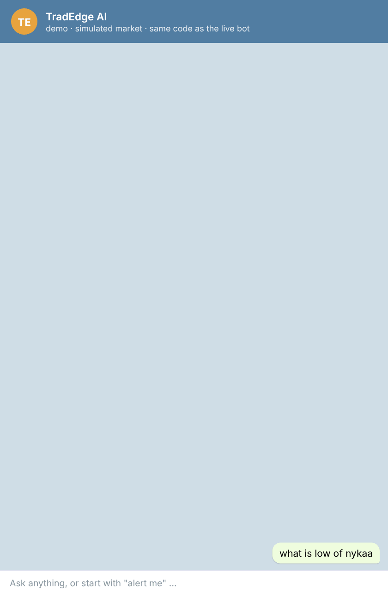
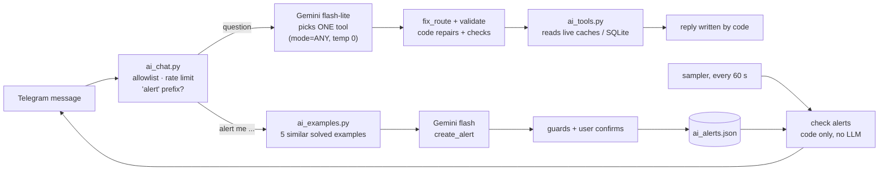

[README.md](https://github.com/user-attachments/files/34564285/README.md)
# TradEdge AI Assistant

[](https://github.com/tenalilogical-bit/tradedge-ai-assistant/actions/workflows/tests.yml)
[](https://github.com/tenalilogical-bit/tradedge-ai-assistant/actions/workflows/evals.yml)

A Telegram assistant for a live NSE F&O trading dashboard. Ask in plain English (or Gujarati / Hinglish),
get answers computed from live market data, and set alerts in one sentence.

**The model never computes a number.** Gemini only picks one of 19 read-only tools and fills in its
arguments. Code validates the arguments, reads the live data and writes every number in the reply.
Alerts are parsed by the model once, confirmed by the user, then checked every minute by plain code
with zero model calls.

> This repo is the AI layer of a private trading app, published with a **fake market**
> (`fake_market/`, a seeded random walk) so anyone can run it. The trading app, its scanner and its
> strategy are not here.

<p align="center">
  
</p>
<p align="center"><sub>Rendered from the real code's output on the simulated market (<code>tools/make_demo_media.py</code>), not drawn by hand.</sub></p>

<!-- Live bot video: drag a short screen recording of the real Telegram bot here (GitHub web editor). -->

## Try it (2 minutes)

```bash
pip install -r requirements.txt
python demo.py --tour        # scripted walk-through, no API key needed
python demo.py --offline     # type questions yourself; replays recorded model outputs
GEMINI_API_KEY=... python demo.py   # any question, real Gemini routing
```

```
you> what is low of nykaa
NYKAA  low 349.15 (10:49) · price 350.06 · day -0.55%

you> alert me when nykaa goes below 348
🔔 New alert — please confirm
Watch: NYKAA price ≤ 348
Check: every minute, 09:15–15:30 · today only · once per stock per day
   [1] ✅ Save   [2] ❌ Cancel

you> /tick 8
🔔 Alert #1 · 11:37 · NYKAA price ≤ 348
1 NYKAA  347.79  day -1.20%
```

That alert is a real case: the model's recorded output was *"day % change, filtered by price < 348"*.
A code guard turned it into the price alert the sentence asked for. The `--tour` replays exactly that.

## Architecture



| File | One job |
| --- | --- |
| `ai_chat.py` | Telegram long polling, allowlist, rate limit, buttons, follow-up memory, sampler + alert thread |
| `ai_llm.py` | Gemini router: tool schemas, retries, fallback model, error kinds (quota vs outage vs 404) |
| `ai_tools.py` | 19 read-only tools, argument validation, `fix_route` repairs, replies, minute sampler |
| `ai_alerts.py` | Alert rules: validate, guards, JSON store, minute check, conversation with buttons |
| `ai_examples.py` | Hybrid retrieval of solved examples: char-trigram TF-IDF + embeddings, merged with RRF |
| `predeploy.py` | Tests + real-model evals → GO / NO-GO |
| `fake_market/` | The public stand-in for the private app's live caches and databases |

## Design decisions

**LLM = router, code = calculator.** Market data never goes to the model, only the question text.
A hallucinated number is not possible because the model never writes one.

**Typed tools, not text-to-SQL.** Three generic layers instead of one tool per question:
- a **metric table** (what × time window: % move, volume, futures volume, OI, PACE, VWAP crossings, ...)
- a small **condition language** over 19 live fields (`open = high`, `price > pdh`, `rvol ≥ 2`, AND, up to 6)
- a **value lookup** for any of those fields on any stock or index

A test is generated from the field list, so a field that can't be asked about fails in CI.

**Alerts: LLM once, code forever.** Turning a sentence into a rule is a language problem, so the model does it
once. Checking the rule every minute is a data problem, so plain code does it: no quota, same answer every time.
Defaults are *today only, once*; the bot asks only for a missing number; an AND rule with one part it can't
watch is refused, never half-saved.

**Retrieval for behaviour (dynamic few-shot).** Before the alert model is called, the 5 most similar
*solved* sentences are retrieved and put in the prompt. Keyword side: character trigrams (handles
"todays" vs "today's", typos, Hinglish). Meaning side: `gemini-embedding-001`. Merged with Reciprocal Rank
Fusion. If embeddings fail, it falls back to keyword-only and the alert still works. Every live failure
becomes a new example, so the bot improves without a code change.

**Model output is treated like user input.** Each live mistake became a deterministic guard that checks the
model's answer against the user's own words, plus a regression test that replays the exact wrong output:

| Guard | Live mistake | Fix in code |
| --- | --- | --- |
| Direction | "new day **low**" → model: new high | low / below vs high / above words → mirror the metric |
| Break vs near | "break today's low" → asked "how much?" | "break" without "near" → new-low event |
| Scope | "**watchlist** stock …" → all stocks | named scope missing from the rule → nothing saved |
| Price level | "below 348" → day % + filter | number + one price condition → price alert |
| Change vs level | "pace changes" → PACE ≥ ? | "change" → change event |
| Today vs history | "gainers today" → yesterday | "today" without past words → live tool |
| Honesty | tool can't do part of the ask | reply ends "⚠️ Can't do yet: …", never a silent swap |

## Testing and evals

| Layer | Size | Catches |
| --- | --- | --- |
| Unit + flow tests (fake model) | 343 tests, ~10 s | code bugs; full alert conversations including the user's reply to every bot question |
| Schema-driven tests | every list tool × limit / order / sector; every metric × window; every field | options the code silently ignores |
| Mirror tests | every high/low case with the side flipped | direction bugs |
| Mutation checks | code broken on purpose → a test must fail | weak tests |
| Real-model evals | 175 question + 83 alert sentences, leave-one-out | how the real model reads a sentence |
| `predeploy.py` | all of the above | GO / NO-GO gate, also run in CI (`evals.yml`) |

Unit tests use a fake model that answers what I expect, so they pass by design. Only evals on the real model
show how it reads a sentence, so they gate the deploy. Leave-one-out: each alert case is scored without its own
example in the prompt, so the score measures unseen sentences.

Eval history (question router): 89% on 35 cases → 97% on 64 → 93% on 125 (median latency 4.5 s → 1.6 s).
The latest run is in **Actions → evals**.

## Reliability

- Free tier: 500 requests/day/model per Google project. Evals use a key from a separate project.
- Daily quota hit → straight to the fallback model, and the user is told when it resets. A 404 model is
  marked dead and skipped.
- Saved alerts survive restarts (atomic JSON writes). After a restart, time-window answers say what the bot
  could not see ("collecting since 12:10, 15-min window ready at 12:25") instead of inventing numbers.
- Only allowlisted chat IDs get an answer; others get silence, and never reach the model.
- Tools copy shared caches under a lock and compute outside it, so the trading engine is never slowed.

## Repo layout

```
ai_*.py            the assistant (same files as the private app)
demo.py            console version of the bot on the fake market
fake_market/       seeded fake session + schema.sql (only the columns the tools read)
state.py           public stand-in: F&O universe + sector map
tools/             make_demo_media.py: rebuilds docs/demo.gif from the real tour output
docs/              demo.gif, demo.png
tests/             343 tests, no network
evals/             real-model eval cases + runner
.github/workflows  tests on every push; real-model evals when AI code changes
```

## Not in this repo

The scanner, conviction score, tiers, PACE bands, scanner states and their rules are private.
`fake_market` uses stand-ins with made-up rules; their names appear only because the tools can be asked
about them. No keys, chat IDs or real market data are committed (`config.py`, `data/`, `logs/` are ignored).

## Next

- Text fields in the condition language (scanner state, tier, sector name).
- The same example retrieval for the question router.
- Expose the 19 tools as an MCP server, so any agent can use the same read-only tools.
